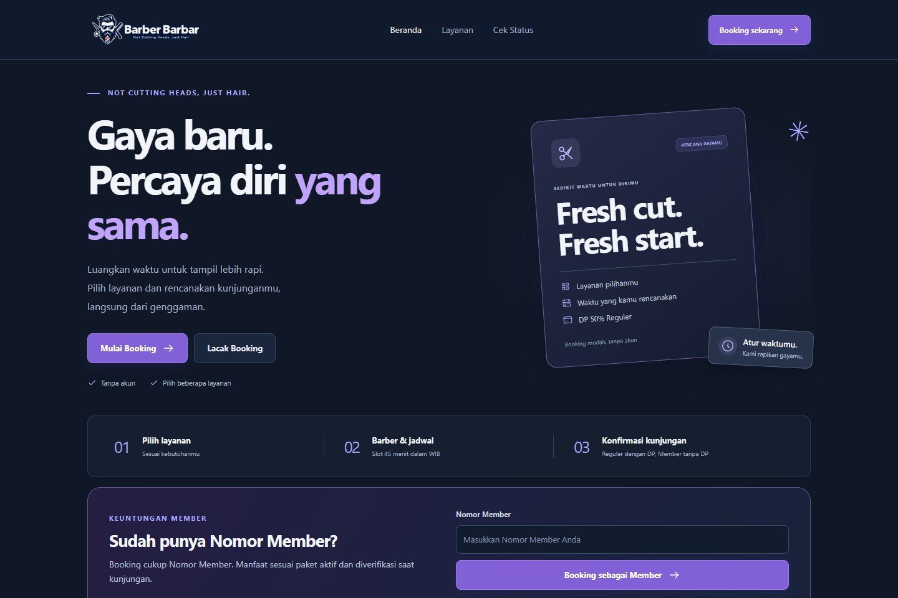
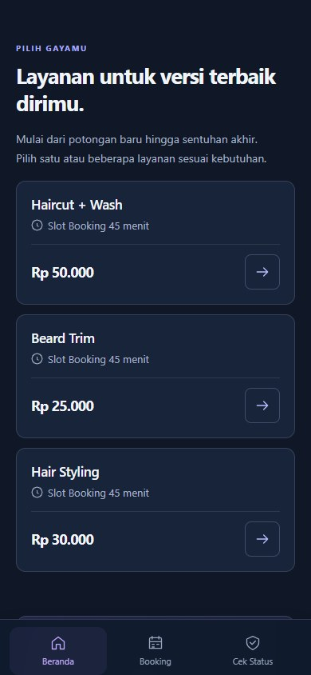
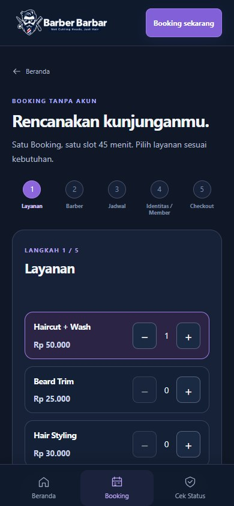
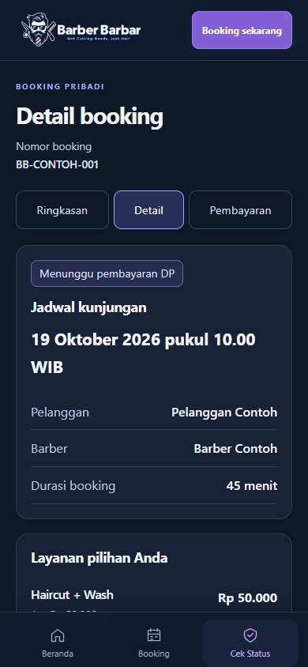
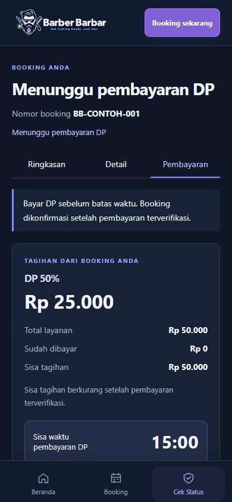
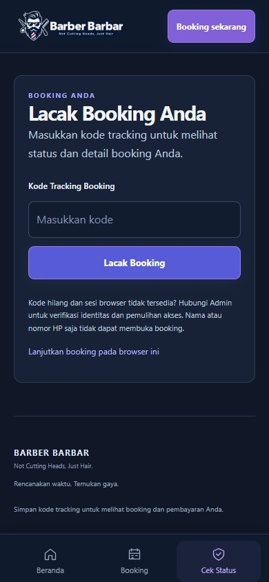

<div align="center">

# BARBER BARBAR

**Not Cutting Heads, Just Hair.**

### Customer Web · mobile-first

Pilih layanan, rencanakan kunjungan dan pantau booking dari browser. Tanpa instal aplikasi.

[Admin & Backend](https://github.com/umarmaulanazakaria/barberbarbar/tree/main) · [Staff Mobile](https://github.com/umarmaulanazakaria/barberbarbar-mobile/tree/main) · [Customer Web](https://github.com/umarmaulanazakaria/barberbarbar-customer/tree/main)

</div>

<a href="docs/showcase/hero.jpg"></a>

*Customer aktif adalah React Web mobile-first; bukan aplikasi React Native Customer.*

> **Tentang gambar:** screenshot diambil ulang dari aplikasi pada source `main` tanggal 18 Oktober 2026. Seluruh respons API untuk capture diintersepsi dengan data sintetis. Tidak ada database atau provider pembayaran yang dihubungi. Status dan nominal contoh adalah ilustrasi UI, **bukan bukti settlement Midtrans**. Tidak ada rekayasa DOM, mockup desain, gambar AI, atau data pelanggan asli. Klik gambar untuk melihat ukuran penuh.

## Dari genggaman sampai kursi barber

| <a href="docs/showcase/katalog.jpg"></a> | <a href="docs/showcase/pilih-layanan.jpg"></a> |
| --- | --- |
| **Katalog** — layanan dan harga dalam tampilan mobile-first. | **Pilih layanan** — atur pilihan sebelum memilih barber dan jadwal. |

| <a href="docs/showcase/booking.jpg"></a> | <a href="docs/showcase/pembayaran.jpg"></a> |
| --- | --- |
| **Booking pribadi** — nomor booking, jadwal dan rincian kunjungan. | **DP online** — nominal dan deadline dari respons backend; tombol Snap mengikuti status booking. |

<a href="docs/showcase/tracking.jpg"></a>

**Tracking privat** — form asli ditampilkan kosong agar kode akses tidak dipublikasikan.

[Asal gambar, versi dan batas capture](docs/showcase/README.md).

## Tiga aplikasi, satu backend

| Aplikasi | Peran |
| --- | --- |
| [Admin Web & Backend](https://github.com/umarmaulanazakaria/barberbarbar/tree/main) | Dashboard operasional, pelanggan, Membership, pesanan, kasir dan laporan. |
| [React Native Staff](https://github.com/umarmaulanazakaria/barberbarbar-mobile/tree/main) | Pelayanan di toko dengan desain Minimal V3: Beranda, Pesanan, Walk-in, Riwayat dan Profil. |
| [Customer Web mobile-first](https://github.com/umarmaulanazakaria/barberbarbar-customer/tree/main) | Katalog, booking tanpa akun, pembayaran dan tracking dari browser HP maupun desktop. |

Ketiganya memakai **Express REST API + Prisma + PostgreSQL** yang sama. Socket.IO memberi sinyal untuk mengambil ulang data REST; harga, kelayakan Member dan status pembayaran tetap ditetapkan backend.

## Dari booking sampai layanan selesai

| Alur | Ringkasan |
| --- | --- |
| Booking Reguler | Pilih layanan, barber dan jadwal; isi identitas tanpa membuat akun. Satu booking memakai slot **45 menit**. |
| DP & konfirmasi | **DP 50%**, batas **15 menit** dari backend. Snap Sandbox bukan penentu status; backend memverifikasi provider sebelum booking dikonfirmasi. |
| Membership | Paket aktif 12 bulan: Haircut + Wash gratis dan layanan lain diskon 10% sesuai kelayakan backend. Booking Member layak tanpa DP; Kartu Member + KTP diperiksa fisik di toko tanpa menyimpan NIK/foto. |
| Walk-in | Operator membuat pesanan Reguler/Member dari toko, memakai quote dan validasi backend yang sama. |
| Pelayanan & pembayaran | Check-in, barber final, pelayanan, selesai, pelunasan sesuai saldo backend, lalu invoice final. Tunai, Transfer dan QRIS mengikuti workflow operator; Snap untuk pembayaran online customer. |

## Teknologi

**React 19 · TypeScript · Vite 7 · Socket.IO Client · Fetch API · Midtrans Snap melalui backend**

## Mulai lokal

Dengan backend aktif pada port 3000:

```powershell
npm.cmd ci
npm.cmd run dev
```

Buka **http://localhost:5175**. Untuk HP pada Wi-Fi yang sama, gunakan **http://IP_LAPTOP:5175**. Proxy development `/api` dan `/socket.io` mengarah ke backend; Server Key tidak pernah diletakkan di browser. Rincian konfigurasi ada pada panel teknis berikut.

## Bukti pengujian dan batas

Build/TypeScript dan suite Customer utama pada **delapan viewport** lulus saat finalisasi `main`; seluruh API suite UI diintersepsi. Integrasi backend diuji terpisah dengan database fixture dan provider mock. Gambar ini bukan bukti Android native atau pembayaran provider nyata. Capture tidak mengklik pembayaran, menerbitkan kode tracking atau membuat booking di database.

**Demo tugas magang dengan batas yang terdokumentasi; bukan klaim Production.**

<details>
<summary><strong>Instalasi, konfigurasi, struktur source dan laporan teknis</strong></summary>

## Struktur

```text
src/App.tsx       Routing hash dan entry aplikasi publik
src/komponen/     Katalog, wizard, detail, pembayaran dan tracking
src/layanan/      Kontrak HTTP, Snap, idempotensi dan realtime
src/domain.ts     Tipe, format dan validasi presentasi
tests/            Tes UI dan kontrak integrasi
docs/             Panduan dan bukti historis
```

## Instalasi dan menjalankan

```powershell
npm.cmd ci
npm.cmd run dev
```

Customer: http://localhost:5175. Backend harus berjalan di port 3000 dan Admin di 5173. Dari HP gunakan http://IP_LAPTOP:5175 pada jaringan yang sama. Vite bind 0.0.0.0 dan proxy /api serta /socket.io menuju backend; tidak perlu hardcode IP backend di browser atau ADB Reverse. Proxy development bukan konfigurasi deployment.

Environment Web opsional, hanya nilai publik:

```dotenv
VITE_API_BASE_URL=/api
VITE_GUEST_BOOKING_ENABLED=true
```

Backend mengaktifkan GUEST_BOOKING_ENABLED, kunci tracking dan origin yang sesuai secara privat. Tidak mengisi Server Key pada Web. Client Key publik dan transaksi Snap disediakan backend. Untuk deployment, sediakan reverse proxy/API origin serta WebSocket yang benar dan HTTPS; vite preview bukan server Production.

## Pembayaran dan privasi

Harga/DP/balance/deadline berasal dari database. Callback success Snap hanya meminta sinkronisasi; backend harus memverifikasi status provider, referensi dan nominal. CONFIRMED tidak ditetapkan oleh frontend. Invoice final memerlukan syarat backend termasuk penyelesaian dan pelunasan. Simpan kode tracking pribadi; jangan mencantumkannya di screenshot, log, issue atau URL publik. Data demo dan fixture tes tidak menjadi bukti pembayaran nyata. Entry publik tidak menyediakan tombol sukses palsu.

## Pemeriksaan

```powershell
npm.cmd run typecheck
npm.cmd run build
node node_modules/@playwright/test/cli.js test --config playwright.customer-principal.config.ts
```

Audit terbaru: build snapshot commit dan working tree lulus; suite Customer utama lulus delapan viewport dengan seluruh API diintersepsi. Test backend terpisah membuktikan integrasi fixture/provider mock. Suite lama yang mengasumsikan formulir satu halaman atau larangan pilihan barber perlu diselaraskan sebelum digunakan sebagai gerbang rilis.

## Batas verifikasi

Audit 18 Oktober 2026 memisahkan snapshot commit dari WIP lokal. TypeScript / build bukan bukti seluruh alur UI atau pembayaran provider. Lihat [laporan audit pusat](https://github.com/umarmaulanazakaria/barberbarbar/blob/main/docs/audit/AUDIT-SISTEM-TERKINI.md). Pengujian integrasi memakai PostgreSQL fixture dan provider mock; bukan settlement Sandbox baru. Perangkat Android/iOS dan printer fisik belum diuji dalam audit ini. Advisory dependency masih terbuka. **Belum siap dinyatakan rilis penuh; bukan Production.**

[Kontrak dan catatan integrasi terbaru](docs/INTEGRASI-TERKINI.md). Bukti settlement historis tetap di dokumentasi backend; tidak diklaim sebagai pengujian provider baru atau seluruh kontrak Member terbaru. Source Native lama bukan target pengembangan aktif dan riwayat/arsip historis tidak dihapus dalam audit ini.

## Versi demo pada main

Branch `main` memuat snapshot fitur terbaru yang digabungkan dengan tetap mempertahankan riwayat. Verifikasi rilis memakai build/TypeScript dan fixture/mock lokal; tidak membuat transaksi nyata atau mengubah data operasional. Jalankan demo dengan konfigurasi lokal dan Midtrans Sandbox existing. Pengujian perangkat HP, printer fisik dan pembayaran provider langsung tidak diklaim lulus dari pengujian ini. WIP lokal tetap terpisah dari versi GitHub.

</details>
